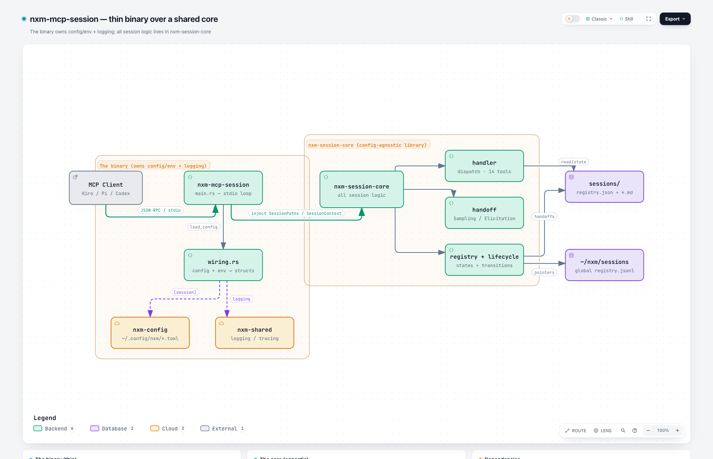
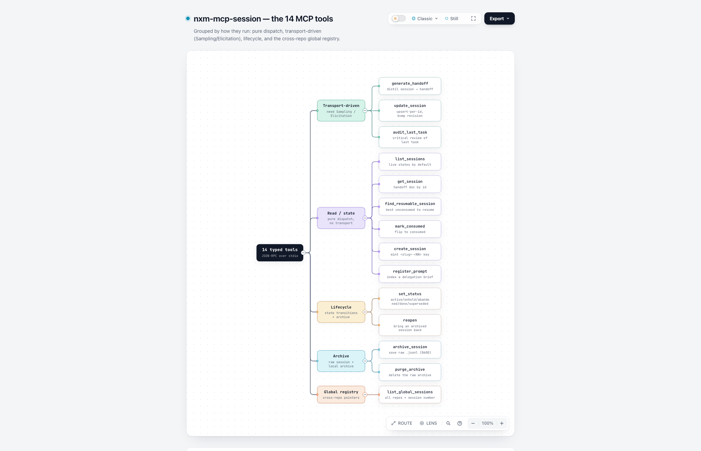
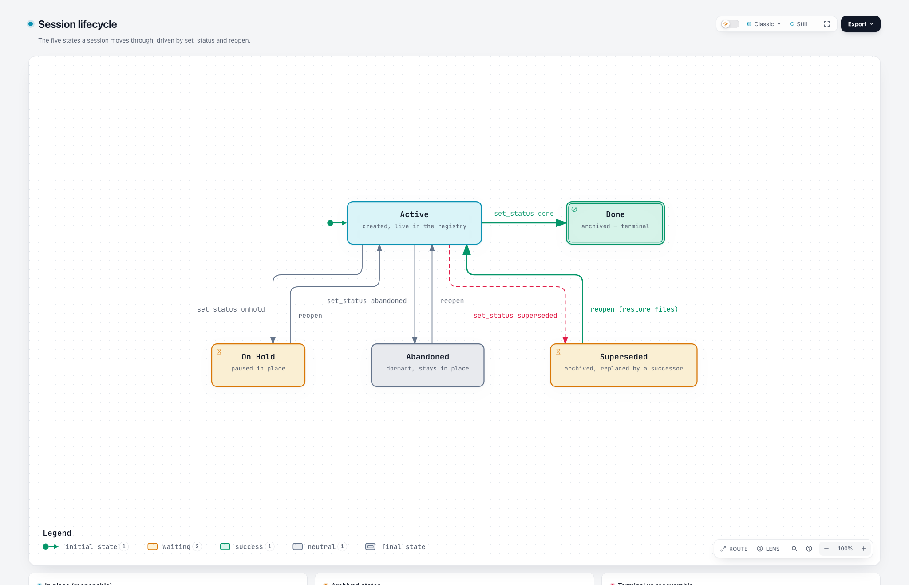
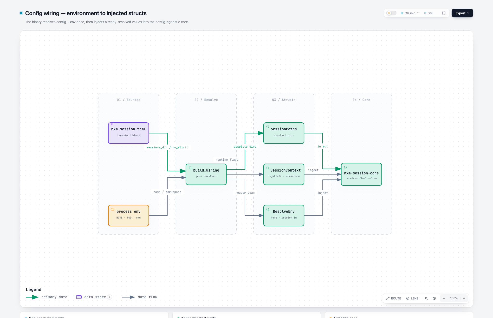

<div align="center">

# nxm-session

<!-- Licensed MIT — part of the nxm tooling. -->
[](#license)
[](https://www.rust-lang.org)
[](#running-the-server)
[](#the-14-tools)
[](CHANGELOG.md)

**Turn a long coding session into a standard handoff document — so a fresh session resumes the work without losing quality.**

`#Rust` · `#MCP` · `#AIagents` · `#SessionHandoff` · `#ContextEngineering` · `#LocalFirst` · `#DeveloperTools`

<br>



</div>

A long agent session accumulates noise, dead ends and prompt drift. Past a
certain fill of the context window the model degrades — more hallucinations,
more syntax slips, "lost in the middle." `nxm-session` answers that not with a
lossy summary but with a **structured, forward-looking handoff**: the goal, the
firm decisions, the failed approaches, the files to read and the next steps,
produced at the right moment and saved as a versionable artifact.

- **Repo:** `dangranaz/nxm-mcp-session`
- **Transport:** MCP JSON-RPC 2.0 over stdio (one JSON object per line), no SDK
- **Shape:** a thin binary over `nxm-session-core` — the same core will back the future `-ee` edition

---

## Scope — why I built it

AI coding agents do their best work early in a session. As the context window
fills, quality falls off a cliff — but the agent keeps going, now confidently
wrong. The usual fix is to paste a hand-written summary into a new chat, which
is lossy, inconsistent, and forgotten under pressure.

I wanted the handoff to be **a standard artifact, not a vibe**: the same shape
every time, written at the first completed task after the threshold, and good
enough that a fresh agent reads it and restarts at full quality.

`nxm-session` is built on three convictions:

1. **Structured beats lossy.** A handoff is not a paragraph of prose — it is a
   document with a fixed schema (goal, decisions, failed approaches, relevant
   files in reading order, next steps) that a new agent can act on directly.
2. **The server never sees your conversation.** Context isolation is by design:
   the synthesis runs on the client's own model through MCP Sampling, so the
   server stays reactive and private — it receives material, it never scrapes it.
3. **One core, two editions.** All session logic lives in a config-agnostic
   library (`nxm-session-core`); the binary only resolves config/env and wires
   logging. The same core backs the public edition and the future enterprise one.

## What you get — the value in one screen

| If you want to… | nxm-session gives you… |
|---|---|
| Resume a long session without re-explaining everything | A standard handoff document, written once, read by the next agent |
| Stop pasting lossy summaries into new chats | A fixed schema: goal, decisions, failed approaches, files, next steps |
| Keep synthesis private and cheap | Sampling on the client's own model — the server never reads your chat |
| Track sessions across a repo and across repos | A local registry + a cross-repo global registry with a session number |
| Archive a raw session and reopen it later | `archive_session` + a lifecycle with reopen/restore |

## How it works

Four diagrams and a one-page explainer. Each image below is a static preview;
click **“open interactive”** for the live, zoomable version (GitHub Pages).

### Architecture — a thin binary over a shared core

[open interactive →](https://dangranaz.github.io/nxm-mcp-session/diagrams/architecture.html)

### The 14 tools — grouped by how they run

[open interactive →](https://dangranaz.github.io/nxm-mcp-session/diagrams/tools.html)

### Session lifecycle — five states and their transitions

[open interactive →](https://dangranaz.github.io/nxm-mcp-session/diagrams/lifecycle.html)

### Config wiring — resolved once, injected into the core

[open interactive →](https://dangranaz.github.io/nxm-mcp-session/diagrams/wiring.html)

**One page:** [how it works →](https://dangranaz.github.io/nxm-mcp-session/explainer/how-it-works.html)
· sources in [`docs/`](docs/).

## The dual model

Two crates, one core — the same shape as the sibling nxm tooling:

| Crate | Role |
|---|---|
| `nxm-session-core` | Core library. Protocol, transport, registry, lifecycle, handoff, global registry. **Config-agnostic: zero `std::env`** — it receives already-resolved values. |
| `nxm-mcp-session` | Thin binary. `main.rs` (stdio loop) + `wiring.rs` (config/env → structs). Owns logging; adds no session logic. |

The binary resolves configuration once and **injects** three structs into the
core: `SessionPaths` (resolved directories), `SessionContext` (runtime flags)
and `ResolveEnv` (the archive-reader seam). The core never reads the
environment, so the same library drops straight into the future `-ee` edition.

## The 14 tools

### Transport-driven (Sampling / Elicitation)

| Tool | What it does |
|---|---|
| `generate_handoff` | Distil the session into a handoff document and register it. Gathers material via Sampling; confirms the write via Elicitation. |
| `update_session` | Upsert-per-id: rewrite an existing `<id>.md` in place and bump its `revision`, never minting a new id. |
| `audit_last_task` | Structured critical review of the last task done under context stress — uses the `code-review` skill if present, else an inline audit. |

### Read / state (pure dispatch, no transport)

| Tool | What it does |
|---|---|
| `list_sessions` | List registry entries; live states by default, `include_dormant` to add abandoned. |
| `get_session` | Return a handoff document by id. |
| `find_resumable_session` | Pick the best unconsumed handoff to resume, given an optional hint. |
| `mark_consumed` | Flip a session to consumed in both the registry and the frontmatter. |
| `create_session` | Mint the next `<slug>-<NN>` key, write a minimal handoff and register it active. |
| `register_prompt` | Index a delegation brief as an artifact of a session (metadata only). |

### Lifecycle, archive and global

| Tool | What it does |
|---|---|
| `set_status` | Move a session between the five states; `done`/`superseded` physically archive it. |
| `reopen` | Bring a superseded/abandoned/on-hold session back to active, restoring files when archived. |
| `archive_session` | Save the raw session `.raw.jsonl` (0600, gitignored, transitory). |
| `purge_archive` | Delete the raw archive and clear `archive_file` in the registry. |
| `list_global_sessions` | Cross-repo session pointers from `~/nxm/sessions/registry.jsonl` + a monotonic session number. |

## The handoff document

A Markdown file with a YAML frontmatter, versionable with Git. It leads with a
paste-ready first message, then the as-built state, the firm decisions, the
**audit of the last task**, the failed approaches to avoid, the relevant files
in reading order, and the next steps. Pointers over prose: it references files
by path instead of duplicating content Git already has.

## Session lifecycle

Five states, driven by `set_status` and `reopen`:

| State | Meaning | Reopenable |
|---|---|---|
| `active` | Live in the registry | — |
| `onhold` | Paused in place | yes, in place |
| `abandoned` | Dormant, stays in place | yes, in place |
| `superseded` | Archived, replaced by a successor | yes — files restored |
| `done` | Archived, terminal | no — create a successor |

`done` and `superseded` physically move the handoff and its linked prompts under
the archive root and drop the entry from the active registry; a terminal state
also reconciles the cross-repo global registry.

## Configuration

### Product config — `~/.config/nxm/nxm-session.toml`

The server reads it itself at startup, whichever client launched it
(honouring `$XDG_CONFIG_HOME`). The binary resolves the final values and the
missing-key defaults; the core receives them already resolved.

```toml
[session]
# Skip the Elicitation confirmation gate on handoff writes.
no_elicit = true
# sessions_dir / archive_root are optional: by default the binary uses
# sessions/ and archive/ relative to the current repo, so each project keeps
# its own local session tree. Set them to force a single absolute location.
```

The cross-repo (global) registry lives under `~/nxm/sessions/` when `$HOME` is
known.

## Installation

```bash
scripts/release.sh            # clippy + tests + install + end-to-end verify
scripts/release.sh --no-test  # skip the test suite
INSTALL_ROOT=~/.cargo scripts/release.sh   # install under a different root
```

The script reinstalls via `cargo install` (which keeps the macOS code signature
valid, unlike a manual copy), re-signs ad-hoc as a safety net, then drives the
**installed** binary over stdio to assert it advertises the full 14-tool
contract — failing loudly on any drift.

> Already-running agent sessions keep the previously spawned server process in
> memory; restart the agent session (or reload its MCP servers) to pick up the
> new version.

## Running the server

The binary speaks MCP JSON-RPC over stdio. Register it with each client:

**Kiro CLI** — `~/.kiro/settings/mcp.json`:

```json
"nxm-session": {
  "command": "nxm-mcp-session",
  "args": ["--transport", "stdio"],
  "env": { "RUST_LOG": "info" }
}
```

**Pi** — `~/.pi/agent/mcp.json`: the same object under `mcpServers`.

**OpenCode** — `~/.config/opencode/opencode.jsonc` under the `mcp` key, type `local`.

## Verifying the install

```bash
printf '%s\n%s\n' \
  '{"jsonrpc":"2.0","id":1,"method":"initialize","params":{}}' \
  '{"jsonrpc":"2.0","id":2,"method":"tools/list","params":{}}' \
  | nxm-mcp-session --transport stdio \
  | grep -o '"name":"[a-z_]*"' | sort -u
# → 14 tools
```

## Non-goals

- Not a lossy chat summariser — it produces a structured, resumable artifact.
- Not a background watcher — it is a reactive MCP server; the trigger lives in the client/harness.
- Not a semantic memory — the raw archive is transitory, distinct from `nxm-memory`.
- No guarantee of security. The value is a standard handoff, context isolation and a clean resume.

## Layout

```
src/main.rs        stdio JSON-RPC loop; captures env, wires logging, injects the structs
src/wiring.rs      the single config/env → SessionPaths/SessionContext/ResolveEnv resolver
docs/diagrams/     architecture, tools, lifecycle, wiring (Archify HTML + source JSON)
docs/explainer/    one-page "how it works"
scripts/release.sh build + verify + (re)install the PATH binary
DESIGN.md          the full design
CHANGELOG.md       per-release history
```

All session logic lives in the `nxm-session-core` dependency, not in this repo.

## Contributing

Contributions are welcome — `nxm-session` is small on purpose.

- **Fork it and make it better.** Small, focused PRs (one logical change each) are easiest to review.
- **Open an issue first for anything larger** — a new tool, a schema change — so we agree on the shape first.
- **Respect the guard-rails.** One logical change per commit, Conventional Commits, and the gates (clippy, tests, fmt) must pass.

## Contributors

Built and maintained by [**@dangranaz**](https://github.com/dangranaz).

## License

Open source, licensed under the **MIT license** ([LICENSE-MIT](LICENSE-MIT)).

Unless you explicitly state otherwise, any contribution you intentionally
submit for inclusion in the work shall be licensed as above, without any
additional terms or conditions.
